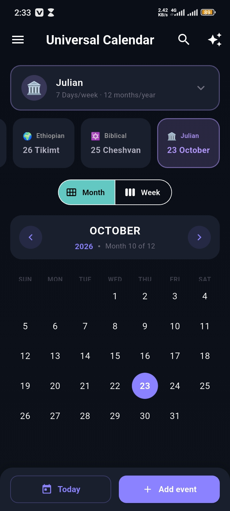
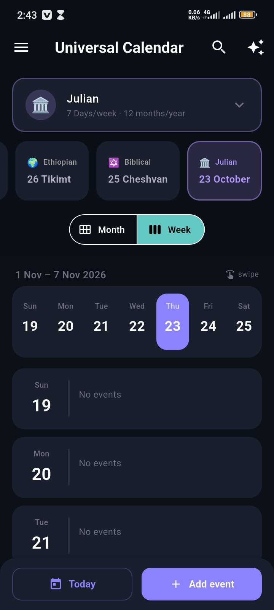
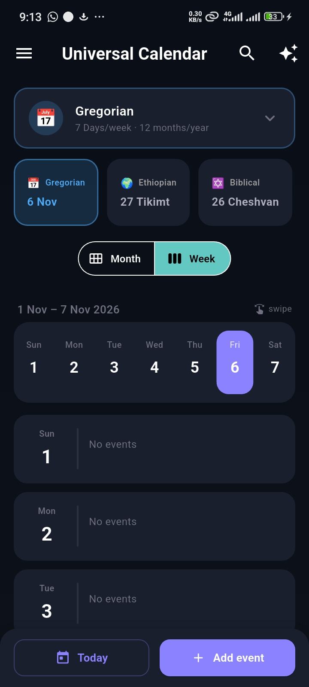
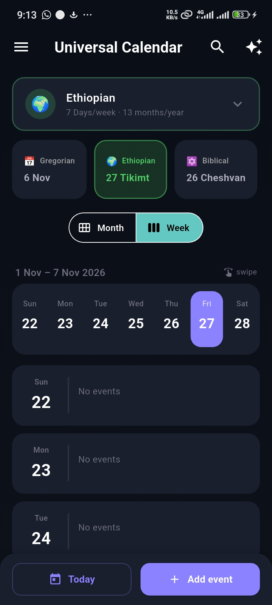
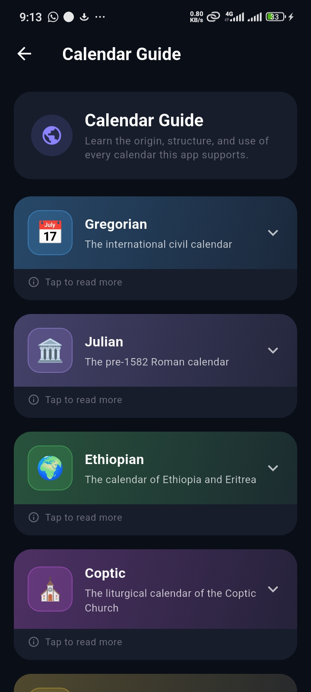
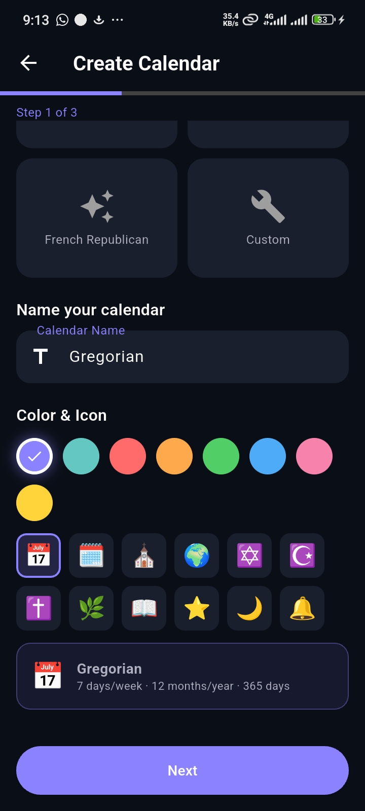
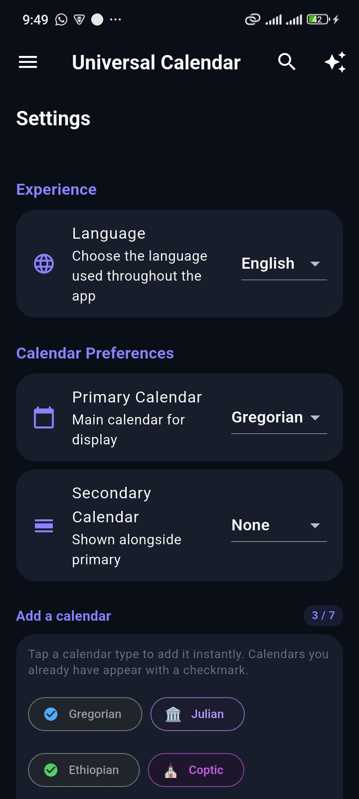
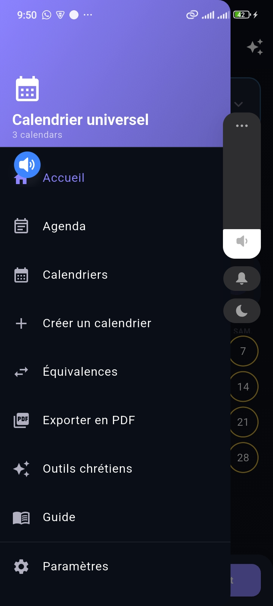
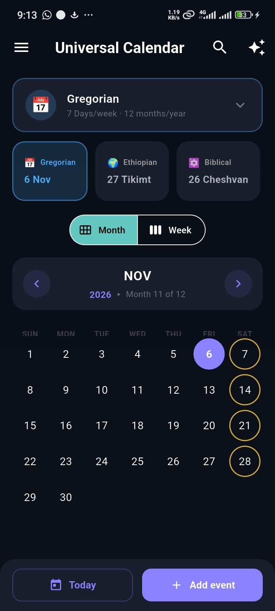
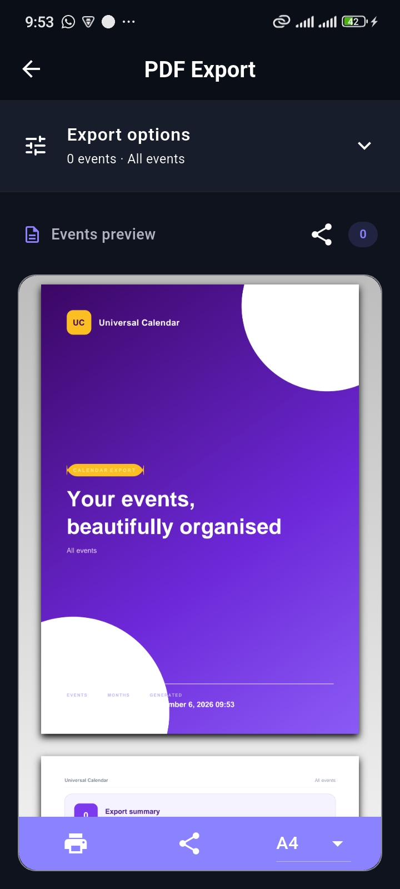

# Universal Calendar

[](https://flutter.dev)
[](https://dart.dev)
[](LICENSE)
[](#license)

**Universal Calendar** is a Flutter calendar workspace built around *user-defined calendar systems* rather than a Gregorian-only model. It ships with seven calendar presets — Gregorian, Julian, Ethiopian, Coptic, Biblical (Hebrew), Islamic (Hijri) and French Republican — lets users create entirely custom calendar structures, and layers a full scheduling suite on top: events with repeating alarms and snooze, dual-calendar comparison, date tooling, PDF export, file-based backup and restore, and Christian devotional tools — in English and French.

---

## Table of Contents

- [Why Universal Calendar](#why-universal-calendar)
- [Features](#features)
  - [Calendar systems](#calendar-systems)
  - [Calendar display and navigation](#calendar-display-and-navigation)
  - [Events and appointments](#events-and-appointments)
  - [Reminders and audible alerts](#reminders-and-audible-alerts)
  - [PDF export](#pdf-export)
  - [Backup and restore](#backup-and-restore)
  - [Storage cleanup](#storage-cleanup)
  - [English and French](#english-and-french)
  - [Christian tools](#christian-tools)
- [Screenshots](#screenshots)
- [Project structure](#project-structure)
- [Requirements](#requirements)
- [Getting started](#getting-started)
- [Build for release](#build-for-release)
- [Testing](#testing)
- [Day view performance](#day-view-performance)
- [Data storage and privacy](#data-storage-and-privacy)
- [Recent changes](#recent-changes)
- [Verification status](#verification-status)
- [License](#license)

---

## Why Universal Calendar

Most calendar apps hard-code Gregorian assumptions — 12 months of fixed lengths, 7-day weeks, Monday-first ordering. Universal Calendar treats the calendar itself as *data*:

- A calendar can have **any number of months** with **independent names and lengths**.
- A week can be **1 to 14 days long**, with fully custom weekday names.
- The **year start** (month + day), year numbering offset and **leap-year rule** (Gregorian, every-4, custom cycle pattern, Hijri, French Republican, or none) are all configurable.
- Conversions between any two installed calendars — Gregorian, Julian, Ethiopian, Coptic, Biblical, Islamic, French Republican, or one the user invented — happen through a shared date engine (`CalendarMath`).

This makes it suitable for liturgical planning, cultural/religious calendar observation, alternate-calendar experimentation, and date-tooling workflows that standard apps cannot express.

---

## Features

### Calendar systems

- **Seven presets included** (`lib/utils/calendar_presets.dart`):

  | Preset | Key | Structure | Notes |
  |---|---|---|---|
  | Gregorian | `gregorian` | 12 months, 7-day week | Sunday-first, `gregorian` leap rule |
  | Julian | `julian` | 12 months, 7-day week | Pre-1582 Roman calendar |
  | Ethiopian | `ethiopian` | 13 months (12 × 30 + Pagume), 7-day week | Year offset −8 |
  | Coptic | `coptic` | 13 months, 7-day week | Liturgical calendar of the Coptic Church |
  | Biblical | `biblical` | 12/13 months, 7-day week | Hebrew lunisolar, custom leap pattern |
  | Islamic | `islamic` | 12 months, 7-day week | Tabular Hijri, year offset −579 |
  | French Republican | `french_republican` | 12 months, **10-day week** | Year offset −1791, `french` leap rule |

- **Step-by-step creator** (`create_calendar_page.dart`) for building a calendar: starting template, name, color/emoji, year structure (days per week, weeks per month), leap-year rule (`none`, `every4`, `gregorian`, `custom` pattern), weekday names, month names and lengths (with *Distribute evenly*), time format (24h / 12h / biblical sunrise-based), date format, and advanced options (seconds, milliseconds).
- **Full editing workflow** (`edit_calendar_page.dart`) for existing calendars: name, icon, color, **year offset with a live preview**, time/date format, week start, plus a read-only structure summary.
- **Special-day management** per calendar (`special_days_page.dart`) with name, month, day, icon and color.
- **Dual-calendar comparison** — a primary and a secondary calendar shown side by side.
- **Offset calculator** — count days between dates, apply an offset to another date, and compute a calendar year offset from a Gregorian year.
- **Date equivalents** lookup — see what a given date corresponds to in every installed calendar.
- **Calendar Guide** — an in-app explainer for each preset (origin, structure, leap year, key facts, when to use).

### Calendar display and navigation

- **Month, Week and Agenda** modes, plus a dedicated **Day view**.
- Month mode supports horizontal swiping with a soft animated transition.
- **Day view** is built on a single `CustomScrollView` (one scrollable, no nested scroll views): a gradient hero, a pinned day strip and a lazily-built agenda. See [Day view performance](#day-view-performance).
- The month header shows its **number within the active calendar** (e.g. *Month 03 of 12*) above the month name — this respects the active calendar, not a fixed Gregorian index.
- Week mode uses the selected calendar's **configured week start and day-count** rather than assuming a Monday-first Gregorian week.
- Week mode swipes by one configured calendar week; Day mode swipes one day at a time.
- **Day mode** shows only the hours that actually hold appointments — a schedule list rather than an empty 24-hour grid. Appointment cards show their start/end time, can be tapped to open details, and all-day appointments display separately above the timeline.
- The day strip is a lazily-built horizontal list that stays centred on the selected day: swiping the page, tapping *Today*, or tapping a chip scrolls the strip, and a fling snaps it back to the selection.
- **Agenda** view with full-text search and range filters (*All*, *Today*, *This week*, *This month*, *Upcoming*) and a per-calendar filter. Its app-bar **Clear all events** action deletes events across every calendar after confirmation and cancels their alarms.
- A first-run **guided tour** (replayable from Settings → *Replay app tour*).

### Events and appointments

- Events retain title, notes, calendar, color and date, and support **multi-day spans** (`endDate`).
- **Editable appointment duration**: 15, 30, 45 min, 1, 1.5, 2 or 3 hours.
- **All-day flag** is stored explicitly. Legacy `00:00` records with no flag keep the old all-day interpretation (backwards-compatible migration).
- **Repeating events**: `once`, `daily` or `weekly`, with an optional *repeat until* end date. Repeating alarms use a rolling schedule so long-running series continue.
- Event detail, day timeline, week summary and agenda all show the appointment time range.
- Updating or deleting an event updates/cancels its pending reminder.
- Full-text **event search** across all calendars (`event_search_page.dart`), plus search inside the agenda.

### Event Alarms

- **Continuous alarm ringing** — Event alarms loop audio and vibration until stopped or snoozed. The alarm screen shows the event, current time, and configured snooze duration.
- **Standard notification controls** — Android shows an alarm notification with Stop and Snooze actions. Full-screen intent is not requested; lock-screen presentation depends on Android notification and device settings.
- **Contextual permissions** — Notification and exact-alarm access are requested when saving an event alarm or from Settings. Without exact-alarm access, Android may deliver reminders late.
- **Alarm audio** — Event alarms and in-app tone previews use the same bundled WAV file for each selected tone. Android plays it through the native alarm audio stream; device volume and audio routing can affect what you hear.
- **11 selectable alarm tones** (`lib/utils/notification_sounds.dart`): Standard Alarm (beep), soft chime, bell, church bells, marimba, harp, drum, birds, hallelujah, piano, and water drops — with instant in-app previews.
- **Alarm offsets** at event time, **5/10/15/30 minutes, 1 hour or 1 day** before.
- **Snooze duration** can be set to 5, 10 or 15 minutes per event.
- **Repeating alarms** for daily and weekly recurring events, including alarms without an end date. End-dated series are scheduled in batches; unbounded series schedule the next occurrence as each alarm rings.
- **Device Reboot Recovery** — Active alarms are preserved and rescheduled across device reboots.

### PDF export

- **Export PDF** in the navigation drawer opens a dedicated export page with two modes:
  - **Events** — a typeset event list for a date range, with optional descriptions and month grouping.
  - **Calendar** — a wall-calendar style PDF for a chosen year, with 1 or 2 months per page, event markers and special-day markers, and a legend.
- The generated PDF is typeset directly from the selected calendar's **own month names, weekday names, week length and month lengths** — not from a Gregorian template.
- The finished PDF is shared/saved as `universal_calendar_events.pdf` or `universal_calendar_<year>.pdf`.
### Backup and restore

- **Export backup** writes a pretty-printed `.json` file (`universal_calendar_backup_<timestamp>.json`) to the temp directory and immediately opens the system **share sheet**, so the user chooses where it goes (Files, Drive, email, …). The temp file is deleted afterwards.
- **Import backup** opens the system **file picker** filtered to `.json`, asks for confirmation, then restores calendars, events and settings. Invalid files are rejected with a clear message.
- The payload includes a `version` field, all calendars, all events and the settings block (primary/secondary calendar, time format, sunrise hour, seconds, day/night indicator, default reminder sound, auto-cleanup period).

### Storage cleanup

- **Auto-delete old events** — choose *Never*, 30, 60, 90, 180 days or 1 year. The cleanup runs once on startup and immediately when the setting changes.
- **Delete old events now** runs the cleanup on demand with the current setting.

### English and French

- Language is selected at **first launch** (full-screen picker) or later in **Settings → Experience → Language**, and persists across restarts.
- Flutter's English/French Material localization delegates and locale-aware date formatting.
- French translations live in `lib/l10n/french_strings.dart` and are looked up through `tr(context, key)`; a missing key falls back to the English string.
- User-entered calendar names, month names, weekday names and event titles are intentionally **preserved exactly as entered** (never machine-translated).

### Christian tools

A dedicated suite of devotional utilities (`christian_tools_page.dart`):

- **Bible verse** of the day.
- **Scripture memory** tracker.
- **Prayer requests** log.
- **Prayer timer**.
- **Gratitude journal**.
- **Fasting tracker**.

---

## Screenshots

| Calendar — month view | Calendar — week view |
|---|---|
|  |  |
|  |  |
,
| Calendar guide | Create calendar |
|---|---|
|  |  |

| Settings | Navigation drawer (French) |
|---|---|
|  |  |

| Calendar — month view | PDF export |
|---|---|
|  |  |

---

## Project structure

```
universal_calendar/
├── lib/
│   ├── main.dart                     # App entry, providers, routes
│   ├── models/                       # CalendarModel, CalendarEvent, SpecialDay, PrayerRequest, …
│   ├── providers/                    # State (calendar, locale, navigation, christian tools)
│   ├── screens/                      # All UI screens (home, day view, agenda, settings, …)
│   ├── services/                     # Notifications, PDF export, backup
│   ├── theme/                        # App-wide Material 3 dark theme
│   ├── utils/                        # Calendar math, presets, formatters, dialogs, tones
│   │   └── notification_sounds.dart  # Alert-tone catalogue + playback helpers
│   └── l10n/                         # Localization (tr() helper, French strings)
├── assets/
│   ├── fonts/                        # Noto Sans Regular / Bold
│   └── sounds/                       # Bundled notification tones (.wav)
├── test/
│   ├── calendar_math_test.dart       # Date-engine reference cases (Julian, Coptic, Hijri, Hebrew, French…)
│   ├── calendar_models_test.dart     # Models, calendars, provider, localization
│   ├── pdf_render_test.dart          # PDF generation smoke test
│   └── widget_test.dart              # Smoke test
├── tools/
│   └── generate_notification_tones.ps1  # Regenerates assets/sounds/*.wav
├── android/ · ios/ · linux/ · macos/ · web/ · windows/
├── LICENSE                           # GNU AGPL-3.0
└── pubspec.yaml
```

---

## Requirements

| Component | Version |
|---|---|
| Flutter | **3.47.5** (target) |
| Dart | `>=3.4.0 <4.0.0` |
| Android | Android 12+ tested; 13+/14+ permission paths implemented |
| Alarm playback | `alarm ^5.15.0` |
| Timezone | `flutter_timezone 4.1.1` + `timezone 0.10.1` |
| UI / state | Material 3, `provider ^6.0.0`, `shared_preferences`, `intl 0.20.2` |
| PDF | `pdf ^3.11.0` + `printing ^5.13.0` |
| File saving / sharing | `path_provider ^2.1.0`, `share_plus ^12.0.0`, `file_picker ^8.1.7` |
| Permissions | `permission_handler ^11.3.1` |
| Bundled assets | Notification tones (`assets/sounds/*.wav`), Noto Sans font |
| Compatibility pins | `image 4.5.4` + `archive 4.0.7` — see [Recent changes](#recent-changes) |

---

## Getting started

### 1. Prerequisites

- Flutter SDK **3.47.5** installed and on your `PATH`. Verify:

  ```sh
  flutter --version
  ```

  The output should report Flutter 3.47.5 and a Dart SDK in the `>=3.4.0 <4.0.0` range.

- An Android device or emulator connected (for `flutter run` / release testing). Desktop and web targets are present in the project but the notification features are Android-specific.

### 2. Install dependencies

```sh
cd universal_calendar
flutter pub get
```

### 3. Format and analyze

```sh
dart format lib
flutter analyze
```

Keep `flutter analyze` clean before committing.

### 4. Run the tests

```sh
flutter test
```

### 5. Run the app

```sh
flutter run
```

The app starts with a splash screen, then the **first-launch language picker** (English / Français), then the **notification permission screen**, then the home screen — each step is skipped once it has been completed.

---

## Build for release

The app targets **Android phones** first; desktop and web targets compile but the notification features are Android-specific.

```sh
# Split per-ABI APKs are smaller to transfer and install by hand
flutter build apk --release --split-per-abi
```

The release APKs are produced in `build/app/outputs/flutter-apk/`:

| File | Device |
|---|---|
| `app-arm64-v8a-release.apk` | Almost every phone from ~2017 onward — **use this one** |
| `app-armeabi-v7a-release.apk` | Older 32-bit devices |
| `app-x86_64-release.apk` | Emulators / x86 tablets |

For a single universal APK instead, run `flutter build apk --release` (larger, works everywhere).

To install on a connected phone:

```sh
adb install -r build/app/outputs/flutter-apk/app-arm64-v8a-release.apk
```

or copy the APK to the phone and open it (allow *Install unknown apps* for the file manager).

---

## Testing

The test suite lives in `test/`:

- **`calendar_math_test.dart`** — covers:
  - Rata Die epoch and round-trips.
  - Julian/Gregorian conversion against reference tables (1582 reform, 13-day skew) and Julian leap years.
  - Ethiopian (Enkutatash, Genna, Pagume) and Coptic (Nayrouz) reference dates.
  - Tabular Hijri conversions and month lengths.
  - Hebrew (Rosh Hashanah, Yom Kippur, Hanukkah, Pesach) with month numbering kept inside 1–13.
  - French Republican epoch (22 Sept 1792 = 1 Vendémiaire an 1).
  - Week-start offsets and weekday headers for Gregorian, Sunday-first, Ethiopian and a renamed start (`Shabbat`).
- **`calendar_models_test.dart`** — covers:
  - Event serialization, legacy migration and reminder/all-day/duration defaults.
  - Custom week structure (e.g. a 5-day week start offset).
  - Leap-year rules (`every4`, `gregorian`, `custom` cycle, `none`).
  - Ethiopian calendar month lengths, Pagume and New Year date math.
  - Hebrew (Biblical) month ordering and full-year conversion validity.
  - `getBiblicalTime` sunrise hour, night hours and ordinal suffixes.
  - `LocaleProvider` lifecycle (fresh install, saved French, set/persist, unsupported language rejection).
  - `CalendarProvider` defaults, reset-all-data and event lookup.
  - First-launch language-picker rendering (catches layout overflow regressions).
  - `tr()` localization lookups and fallback behavior.
- **`pdf_render_test.dart`** — renders a wall-calendar PDF and checks it is produced.
- **`widget_test.dart`** — basic smoke test.

Run with `flutter test`. A clean run prints `All tests passed!`.

> **Note:** Harmless `LateInitializationError` messages for the notification plugin instance may appear in the test log when a test cancels reminders without initializing the plugin. This is expected in a test environment where the platform channel isn't mocked, and does not affect test results or the app at runtime.

---

## Data storage and privacy

- All calendars, events, special days, Christian-tool entries, language choice and app settings are stored **locally** on the device using `SharedPreferences` (JSON-serialized).
- No network calls, analytics or telemetry.
- Exported PDF files and backup `.json` files are written to the app's **documents or temp directory** and handed to the system share sheet — nothing is uploaded.
- **Reset All Data** (in Settings) wipes calendars, events and preferences back to the three built-in default calendars (Gregorian, Ethiopian, Biblical) and cancels all pending reminders.

---

## Day view performance

The day view is tuned for mid-range phones:

- **One scrollable.** The whole screen is a single `CustomScrollView` — hero, pinned day strip and agenda are slivers of it. There is no `SingleChildScrollView` wrapping a `ListView` (the classic nested-scroll jank pattern) and no `shrinkWrap` list inside a scroll view.
- **Lazy agenda.** Rows are built by `SliverList.builder`, so only visible appointments exist as widgets. Hours without appointments are not rendered at all.
- **Indexed lookups.** Events are bucketed by date once and reused until the event list or selected calendar changes, so changing days no longer re-scans the whole event store on every rebuild.
- **Fixed-extent strip.** The day strip uses `itemExtent`, so Flutter never has to measure tiles while scrolling, and only the visible chips are built.
- **Single locale subscription.** The screen watches `LocaleProvider` once (it previously subscribed twice, causing a redundant rebuild path).

---

## Recent changes

### Backup and restore (file-based)
- **Export backup** now writes a real `.json` file and opens the system share sheet (`BackupService.exportBackup`) instead of copying JSON to the clipboard.
- **Import backup** uses the system file picker (`BackupService.pickAndReadBackup`), confirms before replacing data, and reports *Backup restored* / *Invalid backup*.
- The backup payload carries a `version` field plus calendars, events and the full settings block.

### Storage cleanup
- New **Storage** section in Settings: *Auto-delete old events* (Never / 30 / 60 / 90 / 180 days / 1 year) and *Delete old events now*.
- The cleanup runs once on startup when enabled, and immediately when the period changes.

### Reminders
- **11 selectable reminder tones** with in-app previews using the same bundled WAV audio as event alarms.
- **Event alarms** with recurring, snoozeable audio alerts and standard Android notification controls.
- **Repeating events** (`daily` / `weekly`) with an optional *repeat until* date and rolling scheduling for unbounded repeats.
- Localized *Stop* action on the notification.

### Agenda
- The Agenda app bar includes **Clear all events** when events exist. It clearly warns that the action permanently removes events from every calendar and cancels their alarms, then reports how many events were deleted.

### PDF export
- Two export modes: **Events** (list with optional descriptions and month grouping) and **Calendar** (wall calendar, 1 or 2 months per page, event and special-day markers, legend).
- The generated PDF is typeset directly from the selected calendar's own month names, weekday names, week length and month lengths — not from a Gregorian template.

### Day view and editing
- **Day view rewritten** around one `CustomScrollView` with a gradient hero, a pinned day strip and a lazily-built agenda (see [Day view performance](#day-view-performance)).
- **Day strip stays in sync** — swiping, *Today*, and chip taps all scroll the strip, and a fling snaps it back onto the selected day.
- **Year offset is easier to set** — tap the number to type a value, or long-press the ± buttons to step by 100 (useful for the French Republican calendar at −1791). The live three-date preview updates immediately.
- **Hebrew month numbering fixed** — month numbers now stay within 1–13 in leap years (Elul was reported as 14) and week headers line up with the grid for Sunday-first, Ethiopian and renamed week starts.

### Error fixes
- **Missing `pdf_export_page.dart`** — the drawer referenced `PdfExportPage` but the file did not exist, so the project did not compile. The page has been created.
- **`PdfColor.withOpacity` does not exist** — the `pdf` package's `PdfColor` has no `withOpacity` (that is a Flutter `Color` method). The faded empty-day dot in the month grid now uses a pre-computed fainter hex color instead.
- **`path_provider` added as a direct dependency** — the export page imports it directly; it was previously only a transitive dependency.
- **`flutter analyze` is clean** — remaining `use_build_context_synchronously`, `prefer_function_declarations_over_variables`, `unnecessary_this`, deprecated `RadioListTile.groupValue`/`onChanged` (replaced with the modern `RadioGroup` widget) and deprecated `SwitchListTile.activeColor` diagnostics were resolved.

### Dependency compatibility fix
- `image 4.11.0` called `ZLibDecoder().decodeLazy()`, which does not exist in `archive 4.0.9`. This made the entire test suite fail to compile (the error surfaced through `pdf`/`printing`, which pull in `image` and `archive` transitively).
- `image` is pinned to **4.5.4** and `archive` to **4.0.7** in `pubspec.yaml` to keep both packages on a mutually compatible version.

### Test layout fix caught by the test suite
- The first-launch language picker screen used a fixed-height `Column` with `Spacer` widgets, which overflowed by ~23px on small viewports (the "language picker is shown on first launch" test caught a `RenderFlex overflow` assertion).
- The screen now wraps its content in a `SingleChildScrollView` sized by a `LayoutBuilder` so it scrolls on small screens while remaining vertically centered on larger ones.

---

## Verification status

| Command | Result |
|---|---|
| `flutter pub get` | ✅ Dependencies resolve with the pinned `image 4.5.4` / `archive 4.0.7` pair. |
| `flutter analyze` | ✅ No issues found. |
| `flutter test` | ✅ All tests pass. |

**Not verified in this environment:**

- A physical Android device run, real notification delivery and audible reminder playback, reboot-receiver restoration and the exact-alarm permission flow require a device/emulator and were not exercised here. Confirm tone playback and alarm volume on your target phone.
- An APK release build (`flutter build apk --release`) was not performed. Run it after the on-device checks pass.
- Scroll smoothness was reviewed in code (single scrollable, lazy slivers, fixed-extent strip, indexed event lookup) but frame timings on a physical phone were not profiled here — use `flutter run --profile` and DevTools to confirm on your device.

---

## License


